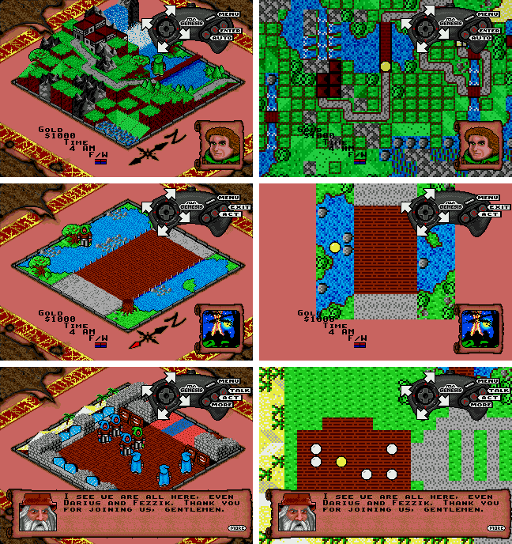
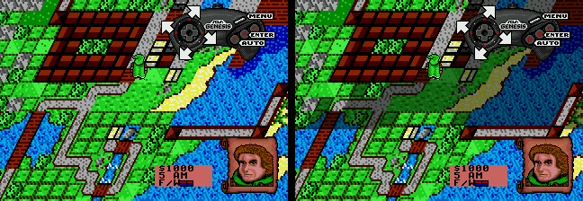
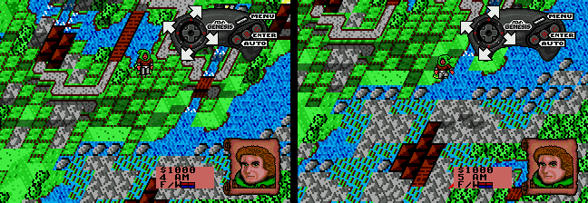
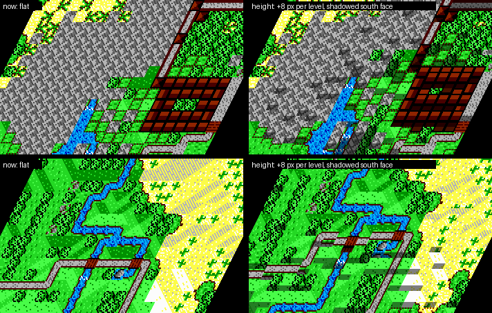
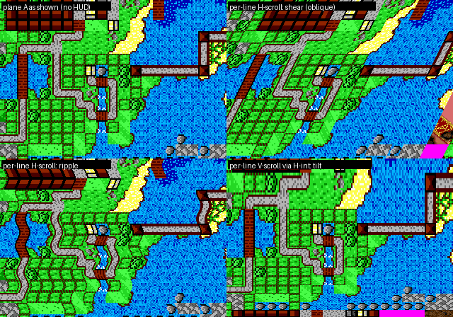
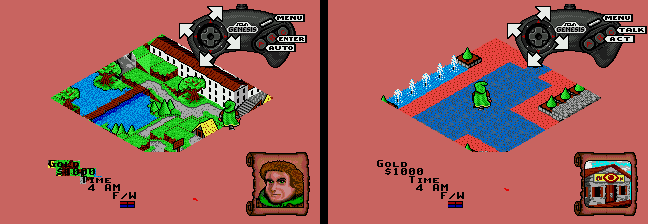

# Smooth picture: why the original is jerky, the top-down test, and the path to a Landstalker-style view (#249)

Status: measured 2026-11-23 on the original ROM and on `make rom
FEATURES=topdown`, frame-stepped in Genesis Plus GX (`tools/md_run.py`,
`tools/md_smooth.py`). Patch: `patches/topdown/README.md`.

*Left: original. Right: topdown. Overworld walk, the Academy room,
the Buc cutscene (same dialogue line, same positions).*

## Short answers

- **Can the game be made smooth on its own engine?** Yes. With the
  world picture replaced by a cheap one, the same game logic runs at
  the original pace with the picture moving every frame in 1-px steps,
  and the 68000 waits for the next tick on 92–93 % of frames.
- **Can the world be split into chunks?** It already is: 252 chunks of
  32×32 (overworld, big rooms) or 11×11 cells, behind a 4-slot cache
  (`map_chunk_cache_read`). The top-down view streams it through a
  32×16-cell ring buffer on the plane, one column or row per cell
  crossed; nothing is decoded per tick.
- **Why didn't the faster-render patches help?** Because render cost is
  only one of five causes, and fixing it alone makes the game *run
  faster*, not move smoother (cause 1 below).

## Five causes (original ROM, measured)

1. **No frame lock.** One main-loop pass = world tick + full render, so
   game speed *is* render speed: 26.7 frames per tick in the overworld
   (25–30), 17.0 in the Academy room, ~22 in the 32×32 room 156. Speed
   differs per scene, and every render speedup sped the game up (the
   "cutscene fast as rocket" verdicts of #234).
2. **Full software re-render every tick.** Clear 26 KB, decode 100 cell
   tops + height stacks with `$E358`, draw figures into the same
   bitmap: ~16 frames per tick (`docs/subcell.md`).
3. **26,496-byte DMA during active display.** The room bank is uploaded
   whenever the render ends, not in VBlank; the VDP feeds active-display
   DMA a few bytes per line, so each update reaches the screen over 3–5
   consecutive frames (torn), with the 68000 held meanwhile.
4. **The picture lives in the window plane**, which the VDP cannot
   scroll (#242): every movement needs a new picture.
5. **Figures are baked into the bitmap at integer cells**: no
   independent figure motion, no sub-cell positions.

## What the top-down test does about each

| Cause | topdown |
|---|---|
| 1 | Frame-locked tick: `td_tick` waits until 26 (overworld) / 17 (rooms) frames have passed. Pace measured: 26.0 / 17.0 frames per tick. |
| 2 | No per-tick render. Cells are drawn once, when they scroll in: 15 or 21 cells per cell crossed; 315 on a scene change. |
| 3 | No bulk DMA in play. Per frame: 2 scroll words + ≤ 12 sprites, written only inside VBlank (a poll that finds the frame past VBlank skips it rather than tear). |
| 4 | World on Plane A/B (table `$0000`, 64×32); the window keeps HUD/menus, its room cells point at the transparent font blank. |
| 5 | Characters are sprites; each slides from where it is drawn to its new cell over one tick; the camera follows the leader's sprite. |

| Measure | original | topdown |
|---|---|---|
| Overworld walk, picture change | one redraw per tick, torn over 3–5 frames | 2,248 × 1 px, 56 × 2 px, 1 × 3 px scroll steps in 13,000 frames |
| Room walk, leader figure | one-cell jump per tick | 272 × 1 px steps, never hidden, 1,150 frames |
| Main thread idle (waiting for the tick) | 0 % | 92–93 % of frames |
| Buc cutscene end state | Buc (6,25) | Buc (6,25) |
| 3 × 30,000 random-input frames | — | no crash, no hang |

The 56 two-pixel steps are frames where no safe point fell inside
VBlank (long game routines); 52 of them follow a held frame.

## Path to a Landstalker-style isometric view

What makes Landstalker smooth is the same split topdown uses: the
background is a ready-made tilemap scrolled by the hardware, characters
are sprites, and the loop is frame-locked. Its 3D look is baked into
the tiles before the game runs; nothing is composed per frame. Rings
of Power composes its isometric picture at run time (cause 2), and the
composition overlaps neighbouring cells, so there is no per-cell tile to
cache (#231). The fix is to move the composition offline:

1. **Keep the topdown scheduler as is** — tick governor, per-frame
   VBlank updates, slides, ring-buffer streaming. It does not care what
   the tiles look like.
2. **Pre-render the isometric world offline — DONE 2026-11-23
   (#252 Track A).** `tools/e358.py` ports the `$E358` composite to
   Python; `tools/e358_atlas.py` renders each location once, cuts it
   into 8×8 tiles, deduplicates, and emits per-area tile sets +
   tilemaps. Byte-exactness: 4,298/4,298 cases match the original ROM
   (fingerprint sweep over all 944 streams × d0/d3 variants + edge
   cases, `tools/e358_capture.py`), 95 full-buffer single-case
   compares byte-exact, and a 102-frame full-view replay (overworld
   + rooms, both `$FF0092` phases) reproduces every terrain-written
   byte — the only live-buffer bytes the replay does not reproduce
   are the figure footprint (one ~200–250-byte blob per frame,
   excluded by design) and, for interior bit-9-clear cells, the
   height stack the live window omits. The atlas check itself is
   exact: a window-only canvas vs a complete port replay is 0
   mismatches on all 102 frames, and vs the live buffer it differs
   only by those figure + stack bytes (0 extra, 0 missing).
3. **Size it — MEASURED 2026-11-23: it does not fit flat.** The
   original's 36×23-tile view holds 249 distinct tiles on average
   (510 max) out of 828. A pre-rendered map aligns tiles globally
   and repeats far more, but not enough:

   | Area | Canvases | Distinct 8×8 tiles | Tile bytes | Tilemap bytes (u16) | Total |
   |---|---|---|---|---|---|
   | Overworld (352×224 cells, 8080×4616 px) | 1 | 75,310 | 2,409,920 | 1,165,540 | 3,575,460 |
   | Big rooms (22 × 32×32) | 22 | 33,015 | 1,056,480 | 337,440 | 1,393,920 |
   | Small rooms (153 × 11×11) | 153 | 38,831 | 1,242,592 | 312,400 | 1,554,992 |
   | **Total** | **176** | **147,156** | **4,708,992** | **1,815,380** | **6,524,372** |

   The 2 MB container holds 2,097,152 bytes, so the flat atlas
   exceeds it by 4,427,220 bytes (3.11× the budget) — and the
   overworld alone (3,575,460) already exceeds it. The container
   is a **2 MB** ROM: the save EEPROM sits at `$200000`
   (`docs/save.md`), so the original board's address space ends at
   2 MB; 4 MB needs a different board or a flash cart with its own
   save mapping. Caveats on the count: the atlas is phase 0 only —
   520 of 2,614 distinct tile words draw differently at phase 1
   (`$FF0092` toggles every tick), so a two-phase atlas would be
   larger still; the 147,156 total is the sum over areas, and
   sharing tiles across areas would cut it (unmeasured); the atlas
   draws every cell complete (height stack included), unlike a live
   window's interior bit-9-clear cells, and it is not wrapped at
   the overworld seam. What fits as-is: the two uses split. The
   detail-on-idle pass (use 1) needs only the visible window's
   cells, so it can use the port live or per-position footprints
   rather than the static atlas; the full atlas (use 2) needs a
   smaller representation — cross-area tile sharing, tilemap
   compression, or per-chunk streaming — before it fits 2 MB.
   That is follow-up work, not this track.

   **Shrink attempt — MEASURED 2026-11-23: no lossless fit**
   (`tools/e358_shrink.py measure`, `build/e358-shrink-measure.json`).
   Budget is the 1,048,576 usable bytes of the 2 MB ROM's second
   megabyte; target was ≤ ~940,000 (10% margin). Levers, all
   measured on the phase-0 atlas:

   | Lever | Result |
   |---|---|
   | Cross-area tile sharing | 135,636 global distinct tiles vs 147,156 per-area sum (saves 368,640 B) |
   | Tiles, $DD5C (game's own format) | 4,340,352 raw → 2,237,967; front-coded (sorted-delta) → **2,061,470** (best $DD5C); bitplane split 2,733,703; per-canvas 2,815,380; zlib reference 1,635,194 |
   | Tile transforms | Flip-canonicalization 131,130 tiles (−3.3%); 2px-shift siblings 1,615; only 4 solid tiles — no special-casing available |
   | Tilemaps, $DD5C area-local | Overworld 816,451 + big rooms 133,321 + small rooms 135,963 = **1,085,735** (delta worse; global remap worse; per-canvas 1,107,417) |
   | Cell-word maps (bound only, no loader) | 119,889 cells, raw 239,778 → $DD5C 95,838 |
   | Phase 1 stored separately | +26,421 tiles, $DD5C 482,257 — cannot be stored; a static atlas is phase-0-only |

   Best $DD5C combination (front-coded tiles + area-local maps) is
   **3,147,205 bytes — 3.00× the budget, gap 2,098,629**. Even with
   cell maps it is 2,157,308 (2.06× over), and even with DEFLATE-class
   zlib — which the game cannot decode — it is 2,198,143 (2.10× over).
   The tile bytes alone (best $DD5C 2,061,470) are 1.97× the whole
   budget. Two corrections to the flat baseline also landed: the
   overworld area's 75,310 distinct tiles exceed u16, so a correct
   flat tilemap needs 3-byte indices there (the 6,524,372 B flat
   total understates it), and the $DD5C greedy encoder is
   pathologically slow on multi-MB noisy inputs (okumura is the
   usable encoder). No shrunk form was implemented and no lossy
   scheme forced. What remains: either a smaller representation
   (fewer distinct tiles — e.g. simplified terrain first, detail
   filled in on idle — or a lossy decision by the owner), or
   per-chunk streaming of the *port's* output instead of a static
   atlas. Detail-on-idle is unaffected: it needs only the visible
   window's cells.

   The 2 MB container is built (issue #252, Track B): `make rom
   SIZE=2m` (`python3 tools/build_rom.py --size 2m`) writes
   `build/rop-<features>-2m.rom` = the 1 MB base unchanged + a second
   megabyte at `$100000–$1FFFFF`, `0xFF`-filled — **1,048,576 usable
   bytes** — with the header ROM-end field at `0x1A4` set to
   `0x001FFFFF` and both checksums fixed (the runtime self-check sums
   only `0x000000–0xFD07B`, so the second megabyte does not change it;
   the header checksum sums `0x200` to end of file, so it covers the
   full 2 MB). `--data FILE[@0xOFFSET]` (repeatable, default offset
   `$100000`) places a payload binary in the second megabyte; the
   manifest records the layout and every payload. Feature blobs still
   allocate only in the first megabyte's padding regions — the second
   megabyte is tile-data room, not allocator space. The save mapping
   is unchanged: the EEPROM window at `$200000` sits immediately after
   the 2 MB ROM's end (see `docs/save.md` §13), and the full #019 save
   harness passes byte-for-byte on the 2 MB ROM (save `0x48`, load
   `0x49`, magic `0x2A`, parity `0x1B`).

   Emulator note (measured 2026-11-23): BlastEm's shipped `rom.db`
   entry for `T-50176` describes the 1 MB retail cart (ROM `last
   FFFFF`), so as shipped it leaves `$100000–$1FFFFF` unmapped —
   reads there return the stale bus word (`0x0801`, the opcode at the
   breakpoint PC), not the tile data — while the EEPROM at `$200000`
   still works. One line in `rom.db` fixes it: in the `T-50176`
   entry, `device ROM / last FFFFF` → `last 1FFFFF` (verified: the
   marker bytes then read back correctly). That is an
   emulator-database limit, not a container defect — real hardware
   and flash carts decode the second megabyte by address lines.
   **Fixed for stock BlastEm (#284):** 2 MB builds now save to
   header-declared SRAM under their own product ID
   (`patches/sram-save`), so no database entry applies and every
   emulator maps the ROM and the save from the header; verified in
   stock BlastEm and GPGX with `tools/md_save_check.py`.
   A 2 MB ROM boots in BlastEm with event logs byte-identical to the
   1 MB original over 600 attract frames, and reaches the game world
   on the frozen original input-replay route (5300 frames,
   `tools/playtest_metrics.py trace`): cadence mean 19.86 frames/tick
   — the original's own number from the #240 table — 23 cells walked
   (7 overworld, 16 room), leader overworld x 0→117, y 0→125, final
   location 30 in room mode, 131 room-DMA uploads.
4. **Stream it** through the same ring buffer, isometric rows instead
   of square cells, switching tile sets at chunk or location edges;
   figures as sprites (their `$197B0` template images), tall objects
   in front via Plane A priority tiles.

**#231 verdict (2026-11-23):** confirmed — there is no per-cell tile
to cache. One `$E358` call paints a median 215 bytes scattered over
a median 3,480-byte span, neighbours overlap ~50 bytes, and a cell's
drawing is a (mask, value) composite, not a tile. But the
composition is exactly reproducible offline and translation-invariant
per cell (the same tile word draws identically anywhere in the
window interior), so the offline atlas is the right fix — it is just
bigger than 2 MB in flat form (step 3). Topdown remains the playable
smooth build until the atlas shrinks to fit; the smooth iso view of
#252 (below) gets smoothness without the atlas: the game's own render,
run rarely and tiled at run time. The atlas question is decided in
#268 (below).

## Follow-up answers (v2, #251)

- **Top-down and isometric in the same 1 MB ROM?** Yes, done: A+B+C
  switches views at any moment, same game state. The whole top-down
  view is 5.3 KB of code and data in the ROM's padding.
- **Sub-cell animation with the freed CPU?** Yes, done: figures are the
  game's own images as sprites, sliding every frame and cycling their
  four walk poses per step; the 68000 is still idle most frames.
- **Is it texture decompression after all?** The CPU cost is the
  terrain composite (`$E358`, ~16 of ~22 frames per tick in a room),
  but the *jerk* is that the picture is rebuilt every tick with no
  frame lock and lives in a plane that cannot scroll (causes 1–3).
  Zoomed-in rooms rebuild the whole picture every tick even when
  nothing moved, so they are jerky without any new decoding.
- **Decode once, then move sprites (like a battle screen)?** Yes —
  that is the top-down view, and the plan for a smooth isometric view
  (card #252): render the terrain only when the camera
  crosses a cell, keep it on a scrollable plane, glide the camera per
  frame, draw figures as cached sprites. Agreed direction (Dayset,
  2026-11-23): simplified terrain first, full detail filled in when
  the player stands still.
- **Tall terrain was very slow — fixable?** Yes. Height costs extra
  composite work per cell; it is paid only when the picture is
  rebuilt. Top-down pays it never; the planned isometric mode pays it
  once per camera step instead of every tick.
- **Row-shifting tricks?** The VDP scrolls each screen line
  horizontally and each 16-px column vertically. That gives shear,
  ripple and (with a per-line interrupt) a tilt, simulated below from
  the real plane — but not a rotation, so it cannot turn the top-down
  map into an isometric one. Per-line interrupts also clash with the
  game writing the VDP from the main thread. Useful for water/heat
  effects; not a renderer.
  Dayset picked the shear: the top-down view now uses it (oblique
  view, rigid under scrolling). The HUD is compacted into a box next
  to the portrait (#255), so the map reaches the bottom edge; a
  parchment strip appears only while a message is shown.
- **Small texture animation in top-down:** done as a VRAM pattern
  swap (water shimmer, see the patch README).
- **Is the top-down view final — can it show height (tall buildings,
  multi-level places)?** Not final. Every map cell carries a height of
  0–7 levels (cell bits 13–15, `docs/maps.md`); the top-down view
  ignores it today. The mock-up below (`tools/td_height_mock.py`,
  ROM data only) draws each level as one tile row (8 px) of lift with
  the south face as the same tiles at half brightness. On the Mega
  Drive that half brightness is free: in shadow/highlight mode a
  priority-0 tile is drawn shadowed, so faces need no extra VRAM, and
  the tile grid stays 8-px aligned, so it still scrolls in hardware.
  Figures on a raised cell move up with it. A building's floors are
  separate locations (one height per cell), so a lighthouse is shown
  floor by floor, as in the original. Q14 answered: **tinted** —
  built (#264), see below.
- **Better textures while standing still?** Possible as the "detail on
  idle" pass of #252: when the leader has not moved for a few ticks,
  redraw the visible cells with richer tiles (the isometric top
  textures resampled offline into 16×16 squares), and return to the
  map tiles when walking. It needs those tiles in the ROM (the 2 MB
  room) and a Python port of the `$E358` decoder to make them. The
  port is done (step 2 above, byte-exact); the tiles' home is the
  open part — the flat atlas does not fit 2 MB (step 3), so the idle
  pass needs the port live or per-position footprints, not the
  static atlas.

- **Does tall terrain slow the original? (#258, attract dragon flight,
  `tools/md_flight.py`)** Only a little. Over 363 flight ticks the
  original takes 21.2 frames per tick with no height under the 10×10
  view, 22.7–23.1 with some, 24.0 over the tallest ground; open sea is
  the fastest (20.8). So height costs about 10–15 %; the visible
  "fast over sea, slow over land" is mostly that sea all looks alike
  while land shows every 28-px jump. Some single ticks take 35–58 frames
  over flat ground. The cause is not traced: a 4-slot chunk-cache model
  does not explain them. The flight's moves come from the game's own
  leader movement (`leader_spawn`, `$01C21A`, called with a direction),
  not from a coordinate table; the path is in the log of the tool's run.
  Top-down flew at the walking period (26 frames per tick), slower than
  the original flight; it now uses 22 frames per tick while the
  leader's travel mode (char +6) is 4, the dragon.

- **Other vessels (#262, `tools/md_vessel_pace.py`):** over open sea at
  (132,76) the original takes 19 frames per tick on the ship, 17 on the
  boat and 19 on the dragon (median). The pace follows what is on
  screen (sea is cheap to draw), not the vessel. Top-down uses 19 for
  boat and ship, 22 for the dragon (its flight average over land and
  sea), 26 on foot. Dino could not be measured (from the start it barely
  moves: 28 frames per tick over 7 moves) and stays at the foot pace.

*Same frame, before and after #264: height-0 cells shadowed (VDP
shadow mode), raised cells normal; the HUD band at the bottom is not
tinted (the HUD's low-priority sprites need priority-free plane rows
there).*

*#297 (Q14 revised to raised): overworld in the top-down view, cells
standing at their height with shadowed south faces, figures on top.
`tools/td_plane_check.py` matches the plane tile for tile (992 of 992
pairs per frame on the explore route) against the ROM's map drawn with
the same painter rule.*

*Overworld from ROM data: flat (as drawn now), raised tiles with
shadowed south faces, and tint only (height 0 shadowed, the two levels
shadow mode gives plane tiles).*

*Line-scroll effects applied to the live top-down plane (VRAM capture,
same arithmetic as the VDP).*

## Smooth iso view (v1, #252)

Built: A+B+C now cycles original → top-down → smooth iso. Design and
numbers: `patches/topdown/README.md` § Smooth iso view.

- **Does decode-once + scroll work for the iso picture?** Yes. With the
  X table shifted so every render lands on the same 8-px grid,
  consecutive renders produce the same tiles at the same global
  positions (interior identical tile for tile; only the window's edges
  and animated water differ). So a render can be cut into tiles once,
  deduplicated (≤ ~460 distinct per render), put on Plane B and
  scrolled by hardware between renders.
- **Measured:** overworld walk 100 % of moving frames in ≤ 2 px steps,
  room 156 99.3 %; at most one render per camera-cell change; the game
  keeps its pace (25–29 frames per cell overworld, 16–21 rooms).
- **The render is the budget.** The game's composite costs ~25 frames
  for the overworld window — a whole tick. Rendering inside the tick
  halved the game's speed, so the render and its commit now run only
  in each tick's spare time, resuming where they stopped; a new picture
  lands about every 2 ticks while walking. The camera chases the game
  camera but stays within a cell of the picture on the plane, so the
  fixed parchment frame (hole = the camera's ±4 cells) never shows an
  edge. Next: the cheap first pass with detail on idle (card #266),
  which would bring a picture per tick.
- **Combat arenas** (grid `$FFB0BC`) are drawn zoomed by the game; the
  top-down picture stands in there.
  Measured for #287 (1 MB build, explore route 6100–9100): no scroll
  and no redraw in 2,999 arena frames, figures sliding in 1–3 px steps
  — smooth already; whether arenas should look isometric is Q18.
- **Decision recorded (Q15):** floating island in a fixed frame, not
  edge to edge.
- **Partial render on a one-cell step (#266, measured, not kept).**
  Built and checked pixel-exact against a full render (dirty 8×8 tiles:
  the entering edge row or column, the old edge row whose stacks go,
  the leaving row's old footprint, tiles entering the hole; cells
  redrawn = those whose 28×30 px box plus lift touches a dirty tile).
  On the explore route every step needed **85–95 of the 100 cells**:
  one edge row alone touches ~50 cells, because each image spans two
  cells sideways and its lift reaches up to 8 tile rows. At 0.25 frames
  per cell that saves ≤ 1–4 frames of a ~25-frame render, less than the
  plan costs to compute. Rejected; a picture per tick needs a cheaper
  composite (own decoder or a first pass without the game's `$E358`),
  not a smaller cell set. Kept from the attempt: the shimmer swap and
  pixel-double tables are built in RAM at load (blob 11,444 → 10,762 B).

## Smooth iso view v2: a picture per tick (#266, #270)

Built: `make rom FEATURES=topdown SIZE=2m`. Design and numbers:
`patches/topdown/README.md` § v2. Short version:

- **Is a picture per tick possible on the game's own composite?** Yes,
  with the 2 MB ROM: the terrain streams converted offline into runs
  (`tools/iso_fast_streams.py`, exact for all 944 x 2 streams) and
  drawn into a linear bitmap decode ~3x faster (overworld ~21 → ~6.5
  frames per picture); with a cheaper commit (11 → 7), a faster cell
  lookup, a per-cell stop and the picture drawn one step ahead of the
  camera, the shown camera stays within a cell of the game camera on
  99.5 % (overworld) and 99.2 % (room 156) of walking frames, steps
  <= 2 px on 99.3 %+ of moving frames, Buc ends at (6,25).
- **Simplified terrain first (your colour + dither idea)?** Measured
  with the fast decoder, the most repeated layer (stream `$230`, the
  filler drawn once per height level under raised cells) is 8 % of the
  decode, ~0.5 frame per overworld picture; a generated fill would save
  about that much, and the whole decode is now ~35 % of a picture. Not
  built: the exact picture already lands every tick.
- **Profile of a picture now** (VBlank PC sampling, overworld):
  decode 41 % (stubs 26, record loop 15), commit 35 % (tile hashing 12,
  pool 7, rows 5, reuse 5, uploads 3), `map_chunk_pos`'s own C code
  11 %, cell lookup 5 %. Next lever if needed: our own cell loop in
  place of `map_chunk_pos` (~2–3 frames).
- **Terrain animation:** standing still, a new picture per terrain
  phase (every tick), so water moves as in the original.
- **Figures in rooms:** 16 cached images (the pool lends 128 tiles)
  and extraction while a render is paused: old poses shown 7.8 % → 0.8 %
  of figure lookups in room 156.
- **Small rooms drawn once on entry (#270 item 1):** not needed any
  more for cadence (a small-room picture costs ~6 frames and is only
  redrawn on a camera step or a terrain phase); its VRAM point is met
  by the pool lending tiles to the figure cache in all rooms.
- **Still open:** tall terrain hiding figures (occlusion) and a hole as
  large as the original's ±5 (see the cards).

## Tools

- `tools/md_run.py` — frame-stepped runner (stable-retro / Genesis Plus
  GX): route files as for the input-replay overlay, per-frame RAM words
  and screen CRC, screenshots. ~500 frames/s, no X display.
- `tools/md_smooth.py` — per-frame background shift (best translation
  in ±4 px; `--hole`: iso view, pixels inside the frame's hole only), redraws, palette changes, and the slot-68 blob position,
  from the rendered frames.
- `tools/md_vram.py` — VRAM/CRAM/VSRAM/registers from a GPGX state.
- `tools/md_iso_cadence.py` — iso picture cadence from RAM per frame:
  picture lag, camera trail (per mode), CPU frames per render/commit.
- `tools/iso_fast_streams.py` — the fast terrain streams (build,
  verify against live renders).
- `tools/md_video.py` — side-by-side 60 fps MP4 of ROMs on routes.

One emulator per process (stable-retro limit); `md_video.py` forks.

## Music on the 68000: worth moving to the Z80? (#304)

Measured 2026-11-24: the VBlank handler's `jsr sound_tick` (`$12F2`)
replaced by `nop`s on a NOLIMIT 2 MB build, iso explore route. Render
CPU per overworld picture 8.07 → 7.98 frames (about 1 %), walking
frames without a picture update 50 / 1,539 vs 53 / 1,303 (no change).
The music tick costs the 68000 about 1 % of its time: moving it to the
Z80 would not make the picture measurably smoother. Not pursued.
