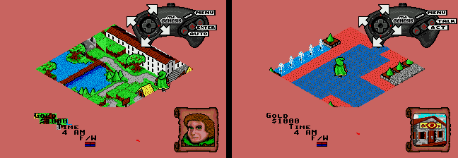

# topdown — smooth top-down test view on the original engine (#249, #251)

A test build that keeps the whole game (logic, input, menus, messages,
map data, RAM) and replaces only the world picture with a cheap
top-down one: the world as 16×16 blocks, characters as the game's own
animated figures, scrolled and moved every frame. **A+B+C** cycles
original → top-down → **smooth iso** (#252, below) → original at any
time (same 1 MB ROM, same save, same game state).

```
make rom FEATURES=topdown          # -> build/rop-topdown.rom (+ .ips)
make rom FEATURES=topdown SIZE=2m  # -> build/rop-topdown-2m.rom: the same
                                   # plus the fast iso terrain (#266)
```

The 2 MB build is the one to play the smooth iso view on: its second
megabyte holds the terrain streams in a form drawn ~3x faster (628 KB,
generated from the ROM at build time by `patches/topdown/data2m.py`), so
the iso picture keeps up with walking. Real hardware or a flash cart
maps it by address lines; BlastEm needs the one-line `rom.db` fix in
`docs/smooth-topdown.md`.


## What you see

- **World:** one 16×16 block per map cell, from the game's own map
  tileset (record 10, the tiles the map screen uses) through the
  descriptor table `$1AE98`, pixel-doubled at load time. Day/night
  works (palette slot 0 is the world palette, as in the original).
- **Figures:** every character with a map-draw record, drawn as a 32×32
  sprite cut from the game's own figure image (template = record+2 +
  record+4 into `$197B0`, drawn once by `$E358` into a spare corner of
  the decode buffer and cached in VRAM, 34 images, LRU, at most one new
  image per frame). Walking cycles the game's four walk poses over each
  cell-to-cell slide. A 16×16 blob is the fallback when an image is not
  cached yet.
- **Oblique view (per-line H-scroll):** each screen line's H-scroll is
  offset by half a pixel per world row (`floor(wy/2)`, pivot on the
  leader's line), so the map is sheared into an oblique view. The shear
  follows world rows, so scrolling stays a rigid 1-px translation;
  figures get the same offset at their cell's centre row. The streamed
  band is 27 cells wide (3 extra each side) to cover the slant.
- **Compact HUD (#255):** the game's window stays over the whole
  screen with the map on Plane B under it, so the map reaches the
  bottom edge. Once per tick `td_hud` moves the HUD words the game drew
  (gold, time, F/W, the food/water bars) into a 3-row box left of the
  portrait (rows 23–25, columns 22–29) and blanks them where the game
  put them; the GOLD/TIME labels are dropped (`$` and AM/PM say it).
  Two low-priority 32×24 sprites (12 solid parchment tiles) are the
  box's backdrop: above the map, under the HUD's high-priority text.
  `td_restore` empties the box before the original view redraws the
  HUD in its own place.
- **Message strip:** when the window's HUD rows (20–25) hold any other
  text (a message), the view switches to the parchment strip: window
  cut to rows 20–27 (`R18=$94`), map on Plane A above it, Plane B a
  static table at `$C000` (bank tiles `$600–$67F`, transparent above
  row 20, parchment from row 20). Any layout install (an R2 write
  through `vdp_ctrl_write`) first drops these registers, so no other
  screen inherits them.
- **No held frames (#260):** long game routines that never touch the
  VDP (`td_vwl`: chunk decompress, leader moves, grid scans, world tick,
  combat turn) get the per-frame update from the VBlank handler itself
  (`td_vint`, no streaming, no image extraction). `TD_BUSY` keeps it out
  while our own code runs, and the streamed cell writes are interrupt-
  masked. The plane holds the whole ring (32×16 cells: 3 extra columns
  left, 8 right for the shear), so the camera can glide up to 60 px
  sideways and 32 px down between streaming points: no clamp jitter.
- **Height tint (#264, Q14):** the VDP runs in shadow/highlight mode
  while the view is up. A pixel is shadowed when neither plane tile
  under it has the priority bit, so map cells of height 0 are drawn at
  half brightness and raised cells (height 1–7, cell bits 13–15) plus
  the void get the priority bit. A priority tile also hides
  low-priority sprites, so the HUD band (screen lines 144–223: frame,
  HUD box, message scroll) is left untinted: plane tile rows from the
  one holding line 152 down carry no priority bit (`td_band` clears /
  restores rows as the camera scrolls, from a 64-byte raised bitmap of
  the ring) and window blanks from row 18 get the priority bit (not
  shadowed, still transparent). Figures above the band and the game's
  own sprites above it (the pad icon) get the priority bit; the game's
  are put back while a menu or upper text is open (`td_gsp`).
- **Water shimmer:** every 32 frames colours 2 and 4 (mid and light
  blue) swap inside the 20 water map tiles: read and remapped 20 tiles a
  frame into a RAM buffer, then all 80 written in one frame —
  every water cell animates with no name-table writes (the game's own
  `±1` tile flip changes almost nothing in the map tileset).
- **Camera:** follows the leader's blob, centred on screen line 84 (the
  HUD covers the bottom), clamped to the map; maps smaller than the
  screen (11×11 rooms) are centred.
- HUD, messages and menus are the game's own window-plane drawing,
  unchanged. While a menu is open the blobs are taken off.

## Smooth iso view (#252)



*Overworld and the Buc room (156) in the smooth iso view.*

The game's own isometric picture, made smooth the way Landstalker is:
render rarely, scroll the result by hardware, figures as sprites.

- **Render on camera step, terrain only.** The game's composite
  (`map_chunk_pos`, the 10×10 window, `$E358` decoder) runs only when
  the game camera cell differs from the picture on the plane, with its
  figure draws (`hero_track`, `map_promote_record`) and its spell-effect
  step skipped (`ti_fig_ht`, `ti_fig_pr`, `ti_spell`). Measured: at most
  one render per camera-cell change (Buc route: 25 renders for 56
  camera/scene changes — renders skip cells the camera has already
  left).
- **Global 8-px grid.** A cell's bitmap x is `14(X−Y) − Ox`; before each
  render the X table `$FFAE7A` is shifted by `e = Ox mod 8` (taken in
  −4..2 so images stay inside the 288-px bitmap), so every render's
  tiles sit on global tile columns; y needs nothing (`8(X+Y) − Oy`,
  `Oy ≡ 6 mod 8`). Consecutive renders give the same tile at the same
  global position (checked: the interior of two renders a cell apart
  matches tile for tile; only the edges and animated water differ).
- **Tile pool.** Each bitmap tile that can show through the hole
  (`ti_crow`, ~408 of 828) is hashed (16-bit, checked against VRAM on a
  match) into a 639-slot pool in the room bank (bank offsets 0–255 and
  401–783), 24-slot window, ages by render: a miss takes the window's
  oldest slot not used by this render (the previous render's only as a
  last resort). Tables in the attract buffer `$FFD2EA` (unused in play).
  One render has up to ~460 distinct tiles.
- **Plane B at global positions.** Bitmap tile (k, r) goes to plane
  column `(Ox'/8 + k) & 63`, row `(cx + cy − 13 + r) & 31`; the rest of
  each row and the 9 rows below the picture are void (parchment), so
  the HUD's text never shows old tiles. `hscroll = −camGX`,
  `vscroll = camGY − 6`, full-screen scroll (R11 = 0), backdrop =
  parchment (R7 = `$1C`), no shadow mode.
- **Resumable render, game pace kept.** The render and the commit work
  only in the tick's spare time: `map_chunk_pos` starts at a saved row
  (`ti_mso`) and stops between rows when the tick has < 3 frames left
  (`ti_row`); the commit goes row by row the same way. The game keeps
  its pace (overworld 25–29 frames per cell, rooms 16–21, as the
  top-down view); a new picture lands about every 2 ticks while walking.
  VBlank updates run inside the composite, the commit and the window
  scan (`td_vwl`), and the tick's own wait gets the full update from the
  VBlank handler (it is idle there), so the glide never waits for them.
- **Camera.** Chases the game camera cell by 1/16 cell per frame per
  axis (1.6× the walking pace, one move per frame, no catch-up), but
  never more than one cell from the picture on the plane.
- **Fixed parchment frame.** The window (which never scrolls) holds
  parchment everywhere except a diamond hole: the camera's cells within
  ±4 (`|x−162|·64 + |y−98|·112 ≤ 7168`, cut at line 152), 44 edge tiles
  for its slanted sides (`tools/td_iso_frame.py` generates the data
  block). The picture covers the camera's cell −5..+4, so the hole
  stays inside it with the camera up to a cell away: render edges never
  show. The game's HUD sits in its own place on the parchment, as in
  the original (no compact box in this view).
- **Figures.** The top-down's sprite figures, placed at
  `(14(x−y), 8(x+y) − 8 − lift)` with the lift `map_chunk_pos` gives
  `hero_track` (`(h + desc bit 7)·7 + desc bit 8·4`, cached per char),
  depth-sorted by `x + y`, culled outside the hole. 8 cached images
  (bank 273–400); a figure whose new pose is not cached yet keeps its
  last image (no blob).
- **Combat arena.** The arena grid (`$FFB0BC`) is drawn zoomed by the
  game; there the top-down picture stands in and the iso view comes
  back after the fight.

### v2 (#266, #270): a picture per tick

Measured with `tools/md_iso_cadence.py` (camera trail = the shown
camera at most one cell behind the game camera, walking frames only)
and `tools/md_smooth.py --hole`, 2 MB build:

| Measure | v1 | v2 (2 MB) |
|---|---|---|
| CPU per picture, overworld (render / commit, frames) | 26 / 11 | 10–11 / 7–8 |
| Camera trail <= 1 cell, overworld walk (explore route) | 53 % | 99.8 % |
| ... overworld + room 156 (`playtest_route_iso2m_buc.txt`) | — | 99.5 % / 99.2 % |
| Steps <= 2 px, overworld / Buc route incl. room 156 | 100 % / 99.3 % | 100 % / 99.3 % (831 of 837) |
| Figure lookups showing an old pose, room 156 | 7.8 % (2.2 extractions/s) | 0.8 % |
| Buc cutscene end | (6,25) | (6,25), loc 156 |

The 1 MB build keeps the game's decoder (render ~31 frames) but gets
the rest: overworld trail 78 %, rooms 70 %.

What v2 changed, in order of gain:

- **Fast terrain streams (2 MB).** Each of the 944 x 2 terrain streams
  is converted offline (`tools/iso_fast_streams.py`, exact against the
  `$E358` port for every stream and checked on 102 live renders) into
  records: one run of a line = h bytes with a transparent nibble, m
  opaque bytes, t masked bytes. `ti_fast` (hooked at `$E358`'s entry,
  only while our render runs) draws a record with one long read and a
  jump into a 24-byte stub that copies the opaque bytes with
  `move.b (a0)+,(a5)+`. To make runs contiguous the iso render goes
  into a **linear** bitmap (144 bytes per line) instead of 8x8 tiles;
  the commit gathers tiles with a 144-byte stride. Decode: ~21 → ~6.5
  frames per overworld render.
- **Commit.** Each tile is first compared (hash, RAM only) with the
  pool slot already at its plane place (`ti_reuse`: most tiles of a step
  stay); plane rows are written word by word only where they differ
  from VRAM (read once per row), void rows known void are skipped
  (VDP access stalls in active display); the pool window start is a
  multiply, a miss takes the first slot not used by the last two
  renders. 11 → 7 frames.
- **Render.** `map_chunk_cache_read` replaced for our render
  (`ti_ccr`: 2 `divu` instead of 6 `divs` + 3 C calls); a 0.5-frame
  buffer clear; the render stops per cell, not per row, with a 1-frame
  margin (was 3).
- **Picture one step ahead.** While the camera keeps stepping, the next
  picture is drawn for the cell it will reach (`ti_target`: last step
  repeated; two steps when a picture takes longer than a tick); a
  render that leaves the camera's path (turn, stop) gives way.
- **32x32 rooms at the original's pace** (22 frames per tick, measured
  in room 156; was 17), which also gives the render room there.
- **Terrain animation (#266 item 3).** Standing still, a new picture is
  drawn when the terrain phase (`$FF0092`, toggled every tick) changes,
  so water animates as in the original; such a render gives way to a
  camera step.
- **Figures (#270 items 2-3).** In rooms the pool lends its last 128
  tiles to 8 more figure images (16; pool 511 slots, `ti_cfg`), and
  images are extracted while a render is paused: `td_extract` swaps its
  640-byte corner with bitmap lines 160+ (never drawn in a linear
  render, never committed) before and after.

### Jitter (#289)

Measured on screen pixels (`tools/md_smooth.py --hole`: `wobble` =
position against its own 15-frame moving average, per axis) and with
`tools/md_iso_cadence.py`, 2 MB build, on the closed-loop Buc route
(`tools/md_buc_route.py ... iso`, each ROM its own route: fixed input
routes drift whenever tick timing changes):

| Measure | #290 | + tick race, held lookahead |
|---|---|---|
| Wobble mean / p95 (px) | 0.45 / 1.33 | 0.37 / 1.00 (Ring of Perfection 0.33 / 0.87) |
| Tick interval = period, overworld / rooms | 8 of 23 / 65 of 205 (up to 35 / 56 frames) | 23 of 23 / 222 of 224 |
| Picture within one cell of the game camera | 79.9 % | 97.0 % |
| Camera trail <= 1 cell (overworld / rooms) | 98.2 % / 92.9 % | 98.1 % / 97.8 % |
| Scroll frames on the route (spurious motion included) | 1,034 | 844 |
| 1 MB build trail, overworld / rooms | 79.0 % / 68.2 % | 93.2 % / 72.3 % |

- **Tick race.** `td_vint` updates the picture itself while td_tick
  waits (PC inside `ti_tw0..ti_tw1`) and stamps `TD_LASTFR`, so the
  wait loop, which waited for `FRAME != TD_LASTFR`, saw a new frame
  only when the VBlank fell between its two instructions: the period
  check ran by chance and ticks ran 0–8 frames late, at random. The
  loop now keeps its own last-seen frame (`TD_MSEEN`). Steps arrive
  evenly, so the one-tick camera glide no longer finishes early and
  waits.
- **Held lookahead.** A picture is put on the plane only within one
  cell (per axis) of the game camera (`ti_hold`). The two-step
  lookahead used when a picture takes longer than a tick was shown
  even after the leader stopped (a wall, a turn), and the camera,
  which stays within a cell of the picture, was pulled a cell forward
  and back. A held picture whose camera stopped stepping (2 periods)
  is dropped; hold time does not count as render latency.
- Room: the remaining 10–14-frame stops are a slow picture (up to 35
  frames when many new tiles enter) committing while the camera is at
  the ±1 clamp of the old one: #279 (asymmetric range + edge checker).
- The 17 blob/void tiles are built at load from one quadrant
  (`td_blobs`, 544 → ~150 bytes), which keeps the 1 MB blob in its
  padding.

| Measure (smooth iso, v1) | value |
|---|---|
| Overworld walk: moving frames in ≤ 2 px steps | 226 / 226 (Buc route), 260 / 260 (explore route) |
| Room 156 (Buc cutscene): moving frames in ≤ 2 px steps | 271 / 273 (99.3 %) |
| Renders per camera-cell / scene change | ≤ 1 (25 for 56) |
| Frames per cell walking: overworld / rooms | 25–29 / 16–21 (top-down: 26 / 17) |
| Buc cutscene end | (6,25), loc 156 (`tools/playtest_route_iso_buc.txt`) |
| 3 × 30,000 random frames (view cycling) + 3 × 30,000 in iso | no crash, no hang |

Measured with `tools/md_smooth.py --hole` (only the pixels inside the
hole count: the frame never moves).

## Measured (tools/md_smooth.py, frame-stepped GPGX, no human eye)

| | original | topdown |
|---|---|---|
| World tick, overworld | 26.7 frames (25–30) | 26.0 frames (24–28) |
| World tick, Academy room | 17.0 frames | 17.0 frames |
| Overworld walk: picture change | one redraw per tick, torn over 3–5 frames by the 26 KB DMA | scroll every frame the camera moves: 2,248 × 1 px, 56 × 2 px, 1 × 3 px in 13,000 frames |
| Room walk: leader figure | jumps one cell per tick | 272 × 1 px steps, 0 jumps in 1,150 frames |
| Whole-picture redraws while walking | every tick | 0 (scene changes only) |
| Main thread waiting for the next tick | 0 % (render-bound) | 92–93 % of frames |
| Buc cutscene (TALK Thalmus, A, A) | Buc ends at (6,25) | Buc ends at (6,25) |
| 3 × 30,000 random-input frames | — | no crash, no hang (longest VBlank gap = a soft reset, same as original) |

Routes: `tools/playtest_route_orig.txt`, `tools/playtest_route_topdown_explore.txt`,
`tools/playtest_route_buc_topdown.txt` (the original needs
`playtest_route_buc_orig.txt`: same targets, its own frame timing).

## How it works

**Frame-locked tick.** The original main loop has no frame lock: one
iteration = world tick + render, so game speed *is* render speed
(17–30 frames per tick depending on the scene). `td_tick` replaces the
render inside `redraw_check`: it waits until the tick period has passed
(TD_T1 = 26 overworld, TD_T2 = 17 rooms — the measured original pace),
and spends the wait updating the picture once per frame.

**One update per frame, only inside VBlank.** An update (`td_frame`)
recomputes the blob positions, the camera, writes the scroll and the
sprites, then streams cells. It runs from safe points of the main
thread — never from the interrupt, because the game writes the VDP
from everywhere and an interrupt would break its address sequences:
the tick wait, the main-loop head, before `combat_turn_run`, the head
of its 56-character loop, after `menu_format`, and inside
`wait_vblank` (messages, menus). A poll that finds the frame already
past VBlank skips it rather than tear; ~2 % of frames are held and
caught up next frame (the 2 px steps above).

**Slides.** A character's cell changes once per tick. Each blob keeps
(target cell, from-pixel, start frame) and moves linearly to the target
over one tick period, starting from where it is drawn now — a step that
lands before the previous slide ended continues smoothly instead of
jumping. Moves of more than 2 cells (doors, teleports) snap.

**Ring-buffer streaming = the world in chunks.** The plane is 64×32
tiles = 32×16 cells; the view needs 21×15. When the camera crosses a
cell edge, one new column (15 cells) or row (21 cells) is read with the
game's own `map_chunk_cache_read` (its 4-slot chunk cache, 32×32-cell
chunks) and written off-screen. A full redraw (315 cells, ~3 frames)
happens only on a scene change. Inside `wait_vblank` the update does
not stream (the caller may hold game state) and the camera is clamped
to the cells already in the plane.

**Window plane.** The original draws the room picture into the
full-screen window as an identity map of 828 tiles at `$FF8674`, over
the parchment on Plane B. Here Plane A/B (table `$0000`, 64×32) carry
the world; every window word that points into the room bitmap is
written as the transparent font blank — at the source, in
`gfx_tilemap_draw` / `gfx_tilemap_fill_seq` (`td_vdw`), plus a full
scan per tick as a backstop. The freed room bank holds our tiles: 256
map quadrants, 1 blank, 16 blob tiles.

**Sprites.** Blobs use slots 68–79 (the game's chain ends at 67) and
are linked in at the head of the chain: sprite 0 → blobs → the game's
first sprite. `menu_format` rewrites sprite 0 every pass, so the update
after it re-links.

### Hooks

| Site | Was | Now |
|---|---|---|
| `$00D2BE` | `tst.w $FF00AC` (main loop head) | `jsr td_poll_head` |
| `$00D97E` | `jsr combat_turn_run` | `jsr td_poll_turn` |
| `$0118A6` | `jsr vdp_data_write` (gfx_tilemap_draw) | `jsr td_vdw` |
| `$01191A` | `jsr vdp_data_write` (gfx_tilemap_fill_seq) | `jsr td_vdw` |
| `$013876` | `move.w $FF0016,d0` (wait_vblank loop) | `jsr td_wv` |
| `$01B958` | `jsr clear_decode_buffer` | `jsr td_tick` |
| `$01B95E` | `move.w $FF0E90,-(a7)` … `jsr map_chunk_pos` | `bra $01B970` |
| `$01B97E` | `jsr menu_format` | `jsr td_menufmt` |
| `$01B9E8` | `jsr dma_upload` (room DMA) | `jsr td_dma` (original view only) |
| `$001352` | joypad queue pop | `jsr td_pad` (A+B+C = switch view) |
| `$00127A` | `addq.l #1,frame` (VBlank handler) | `jsr td_vint` |
| `$01BD98`, `$01BF14` | `jsr hero_track` (in `map_chunk_pos`) | `jsr ti_fig_ht` (skipped while iso renders) |
| `$01BDE4`, `$01C006` | `jsr map_promote_record` | `jsr ti_fig_pr` (likewise) |
| `$01C0DE` | `jsr spell_effect_step` | `jsr ti_spell` (likewise) |
| `$01BA5A` (+`$01BA60` 2 nops) | `jsr map_scroll_offset; addq #4,a7; moveq #0,d4` | `jsr ti_mso` (iso: start at a saved row) |
| `$01C0CC` | `addq.w #1,d4; cmp.w #$a,d4` (row step) | `jsr ti_row` (iso: stop when the tick's time is up) |
| `$0246C0` | place-chars loop head | `jsr td_poll_pgc` |
| `$00E358` | `moveq #0,d2; move.w 4(a7),d2` (entry) | `jmp ti_e358` (iso render, 2 MB: `ti_fast`) |
| `$01BA84` | `jsr map_chunk_cache_read; addq #4,a7` | `jsr ti_ccr` (iso render: fast lookup) |
| `$01BA66` | `move.w d4,d0; add.w 8(a6),d0` (cell head) | `jsr ti_cell` (iso: resume column, stop per cell) |
| `$00D9E6` | `move.w d0,vdp_ctrl` (vdp_ctrl_write) | `jmp td_vctl` (drop our registers on a layout install) |
| `$0227FC` | `move.w d4,d0; muls.w #$34,d0` (char loop head) | `jsr td_poll` |

RAM `$FFDC00–$FFE6BF` (+ the iso pool tables at `$FFD2EA–$FFDA07`, the attract buffer) (free in play: the attract buffer ends at
`$FFDBEA`, the stack low-water mark on the test routes is `$FFE972`;
the boot RAM clear resets it). Blob 11,870 bytes at `$FD0CC` (padding, 12,084) in the 1 MB build; the 2 MB build assembles with `SIZE2M` (the fast-terrain code) and places its 12,392-byte blob at `$1F0000`, the second megabyte's code room, with the fast streams at `$100000` (`ISOFAST`). The figure cache is 25 images (slots skip the Plane B table); up to 10 figure sprites plus the 2 HUD-box sprites.

## Limits (test build)

- Smooth iso: tall terrain does not hide figures behind it (figures are
  sprites above Plane B); the hole is the camera's ±4 cells (the
  original shows ±5). Both are open cards (see `docs/smooth-topdown.md`,
  v2). The 1 MB build renders with the game's decoder and trails more.

- The bottom 80 lines (HUD band) show the map untinted; height is
  visible in the play area above it. While a menu is open, raised cells
  can cover parts of the pad icon (it goes back to low priority so it
  does not cover the menu).

- Projectiles and spell effects (drawn by the removed renderer) are not
  shown in the top-down view; switch to the original view for them.
- `map_chunk_pos` is skipped entirely, so its record promotion between
  the two figure grids (`$2343A`, draw order only) no longer happens.
- One tick period per mode: rooms whose original render was slower
  than 17 frames (e.g. the 32×32 room 156: 22 frames/tick) now walk
  faster than the original. TD_T1/TD_T2 are the knobs.
- Sprite slots 68–79 assume the game's chain stays below 68 (true on
  every tested screen).
- Measured in Genesis Plus GX (stable-retro); smoke-tested in BlastEm
  0.6.3 (input-replay overlay moved to `$FF000`, overworld → room →
  walking, 4,700 frames). Not yet on hardware.
