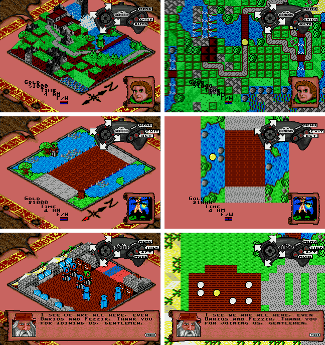

# topdown — smooth top-down test view on the original engine (#249, #251)

A test build that keeps the whole game (logic, input, menus, messages,
map data, RAM) and replaces only the world picture with a cheap
top-down one: the world as 16×16 blocks, characters as the game's own
animated figures, scrolled and moved every frame. **A+B+C** switches
between this view and the original isometric one at any time (same
1 MB ROM, same save, same game state).

```
make rom FEATURES=topdown        # -> build/rop-topdown.rom (+ .ips)
```



## What you see

- **World:** one 16×16 block per map cell, from the game's own map
  tileset (record 10, the tiles the map screen uses) through the
  descriptor table `$1AE98`, pixel-doubled at load time. Day/night
  works (palette slot 0 is the world palette, as in the original).
- **Figures:** every character with a map-draw record, drawn as a 32×32
  sprite cut from the game's own figure image (template = record+2 +
  record+4 into `$197B0`, drawn once by `$E358` into a spare corner of
  the decode buffer and cached in VRAM, 34 images, LRU, at most one new
  image per frame). Walking cycles the game's four walk poses over each
  cell-to-cell slide. A 16×16 blob is the fallback when an image is not
  cached yet.
- **Oblique view (per-line H-scroll):** each screen line's H-scroll is
  offset by half a pixel per world row (`floor(wy/2)`, pivot on the
  leader's line), so the map is sheared into an oblique view. The shear
  follows world rows, so scrolling stays a rigid 1-px translation;
  figures get the same offset at their cell's centre row. The streamed
  band is 27 cells wide (3 extra each side) to cover the slant.
- **Compact HUD (#255):** the game's window stays over the whole
  screen with the map on Plane B under it, so the map reaches the
  bottom edge. Once per tick `td_hud` moves the HUD words the game drew
  (gold, time, F/W, the food/water bars) into a 3-row box left of the
  portrait (rows 23–25, columns 22–29) and blanks them where the game
  put them; the GOLD/TIME labels are dropped (`$` and AM/PM say it).
  Two low-priority 32×24 sprites (12 solid parchment tiles) are the
  box's backdrop: above the map, under the HUD's high-priority text.
  `td_restore` empties the box before the original view redraws the
  HUD in its own place.
- **Message strip:** when the window's HUD rows (20–25) hold any other
  text (a message), the view switches to the parchment strip: window
  cut to rows 20–27 (`R18=$94`), map on Plane A above it, Plane B a
  static table at `$C000` (bank tiles `$600–$67F`, transparent above
  row 20, parchment from row 20). Any layout install (an R2 write
  through `vdp_ctrl_write`) first drops these registers, so no other
  screen inherits them.
- **No held frames (#260):** long game routines that never touch the
  VDP (`td_vwl`: chunk decompress, leader moves, grid scans, world tick,
  combat turn) get the per-frame update from the VBlank handler itself
  (`td_vint`, no streaming, no image extraction). `TD_BUSY` keeps it out
  while our own code runs, and the streamed cell writes are interrupt-
  masked. The plane holds the whole ring (32×16 cells: 3 extra columns
  left, 8 right for the shear), so the camera can glide up to 60 px
  sideways and 32 px down between streaming points: no clamp jitter.
- **Height tint (#264, Q14):** the VDP runs in shadow/highlight mode
  while the view is up. A pixel is shadowed when neither plane tile
  under it has the priority bit, so map cells of height 0 are drawn at
  half brightness and raised cells (height 1–7, cell bits 13–15) plus
  the void get the priority bit. A priority tile also hides
  low-priority sprites, so the HUD band (screen lines 144–223: frame,
  HUD box, message scroll) is left untinted: plane tile rows from the
  one holding line 152 down carry no priority bit (`td_band` clears /
  restores rows as the camera scrolls, from a 64-byte raised bitmap of
  the ring) and window blanks from row 18 get the priority bit (not
  shadowed, still transparent). Figures above the band and the game's
  own sprites above it (the pad icon) get the priority bit; the game's
  are put back while a menu or upper text is open (`td_gsp`).
- **Water shimmer:** every 32 frames colours 2 and 4 (mid and light
  blue) swap inside the 20 water map tiles: read and remapped 20 tiles a
  frame into a RAM buffer, then all 80 written in one frame —
  every water cell animates with no name-table writes (the game's own
  `±1` tile flip changes almost nothing in the map tileset).
- **Camera:** follows the leader's blob, centred on screen line 84 (the
  HUD covers the bottom), clamped to the map; maps smaller than the
  screen (11×11 rooms) are centred.
- HUD, messages and menus are the game's own window-plane drawing,
  unchanged. While a menu is open the blobs are taken off.

## Measured (tools/md_smooth.py, frame-stepped GPGX, no human eye)

| | original | topdown |
|---|---|---|
| World tick, overworld | 26.7 frames (25–30) | 26.0 frames (24–28) |
| World tick, Academy room | 17.0 frames | 17.0 frames |
| Overworld walk: picture change | one redraw per tick, torn over 3–5 frames by the 26 KB DMA | scroll every frame the camera moves: 2,248 × 1 px, 56 × 2 px, 1 × 3 px in 13,000 frames |
| Room walk: leader figure | jumps one cell per tick | 272 × 1 px steps, 0 jumps in 1,150 frames |
| Whole-picture redraws while walking | every tick | 0 (scene changes only) |
| Main thread waiting for the next tick | 0 % (render-bound) | 92–93 % of frames |
| Buc cutscene (TALK Thalmus, A, A) | Buc ends at (6,25) | Buc ends at (6,25) |
| 3 × 30,000 random-input frames | — | no crash, no hang (longest VBlank gap = a soft reset, same as original) |

Routes: `tools/playtest_route_orig.txt`, `tools/playtest_route_topdown_explore.txt`,
`tools/playtest_route_buc_topdown.txt` (the original needs
`playtest_route_buc_orig.txt`: same targets, its own frame timing).

## How it works

**Frame-locked tick.** The original main loop has no frame lock: one
iteration = world tick + render, so game speed *is* render speed
(17–30 frames per tick depending on the scene). `td_tick` replaces the
render inside `redraw_check`: it waits until the tick period has passed
(TD_T1 = 26 overworld, TD_T2 = 17 rooms — the measured original pace),
and spends the wait updating the picture once per frame.

**One update per frame, only inside VBlank.** An update (`td_frame`)
recomputes the blob positions, the camera, writes the scroll and the
sprites, then streams cells. It runs from safe points of the main
thread — never from the interrupt, because the game writes the VDP
from everywhere and an interrupt would break its address sequences:
the tick wait, the main-loop head, before `combat_turn_run`, the head
of its 56-character loop, after `menu_format`, and inside
`wait_vblank` (messages, menus). A poll that finds the frame already
past VBlank skips it rather than tear; ~2 % of frames are held and
caught up next frame (the 2 px steps above).

**Slides.** A character's cell changes once per tick. Each blob keeps
(target cell, from-pixel, start frame) and moves linearly to the target
over one tick period, starting from where it is drawn now — a step that
lands before the previous slide ended continues smoothly instead of
jumping. Moves of more than 2 cells (doors, teleports) snap.

**Ring-buffer streaming = the world in chunks.** The plane is 64×32
tiles = 32×16 cells; the view needs 21×15. When the camera crosses a
cell edge, one new column (15 cells) or row (21 cells) is read with the
game's own `map_chunk_cache_read` (its 4-slot chunk cache, 32×32-cell
chunks) and written off-screen. A full redraw (315 cells, ~3 frames)
happens only on a scene change. Inside `wait_vblank` the update does
not stream (the caller may hold game state) and the camera is clamped
to the cells already in the plane.

**Window plane.** The original draws the room picture into the
full-screen window as an identity map of 828 tiles at `$FF8674`, over
the parchment on Plane B. Here Plane A/B (table `$0000`, 64×32) carry
the world; every window word that points into the room bitmap is
written as the transparent font blank — at the source, in
`gfx_tilemap_draw` / `gfx_tilemap_fill_seq` (`td_vdw`), plus a full
scan per tick as a backstop. The freed room bank holds our tiles: 256
map quadrants, 1 blank, 16 blob tiles.

**Sprites.** Blobs use slots 68–79 (the game's chain ends at 67) and
are linked in at the head of the chain: sprite 0 → blobs → the game's
first sprite. `menu_format` rewrites sprite 0 every pass, so the update
after it re-links.

### Hooks

| Site | Was | Now |
|---|---|---|
| `$00D2BE` | `tst.w $FF00AC` (main loop head) | `jsr td_poll_head` |
| `$00D97E` | `jsr combat_turn_run` | `jsr td_poll_turn` |
| `$0118A6` | `jsr vdp_data_write` (gfx_tilemap_draw) | `jsr td_vdw` |
| `$01191A` | `jsr vdp_data_write` (gfx_tilemap_fill_seq) | `jsr td_vdw` |
| `$013876` | `move.w $FF0016,d0` (wait_vblank loop) | `jsr td_wv` |
| `$01B958` | `jsr clear_decode_buffer` | `jsr td_tick` |
| `$01B95E` | `move.w $FF0E90,-(a7)` … `jsr map_chunk_pos` | `bra $01B970` |
| `$01B97E` | `jsr menu_format` | `jsr td_menufmt` |
| `$01B9E8` | `jsr dma_upload` (room DMA) | `jsr td_dma` (original view only) |
| `$001352` | joypad queue pop | `jsr td_pad` (A+B+C = switch view) |
| `$00127A` | `addq.l #1,frame` (VBlank handler) | `jsr td_vint` |
| `$0246C0` | place-chars loop head | `jsr td_poll_pgc` |
| `$00D9E6` | `move.w d0,vdp_ctrl` (vdp_ctrl_write) | `jmp td_vctl` (drop our registers on a layout install) |
| `$0227FC` | `move.w d4,d0; muls.w #$34,d0` (char loop head) | `jsr td_poll` |

RAM `$FFDC00–$FFE14F` (free in play: the attract buffer ends at
`$FFDBEA`, the stack low-water mark on the test routes is `$FFE972`;
the boot RAM clear resets it). Blob 6,358 bytes at `$FD0CC–$FE9A1` (padding). The figure cache is 25 images (slots skip the Plane B table); up to 10 figure sprites plus the 2 HUD-box sprites.

## Limits (test build)

- The bottom 80 lines (HUD band) show the map untinted; height is
  visible in the play area above it. While a menu is open, raised cells
  can cover parts of the pad icon (it goes back to low priority so it
  does not cover the menu).

- Projectiles and spell effects (drawn by the removed renderer) are not
  shown in the top-down view; switch to the original view for them.
- `map_chunk_pos` is skipped entirely, so its record promotion between
  the two figure grids (`$2343A`, draw order only) no longer happens.
- One tick period per mode: rooms whose original render was slower
  than 17 frames (e.g. the 32×32 room 156: 22 frames/tick) now walk
  faster than the original. TD_T1/TD_T2 are the knobs.
- Sprite slots 68–79 assume the game's chain stays below 68 (true on
  every tested screen).
- Measured in Genesis Plus GX (stable-retro); smoke-tested in BlastEm
  0.6.3 (input-replay overlay moved to `$FF000`, overworld → room →
  walking, 4,700 frames). Not yet on hardware.
